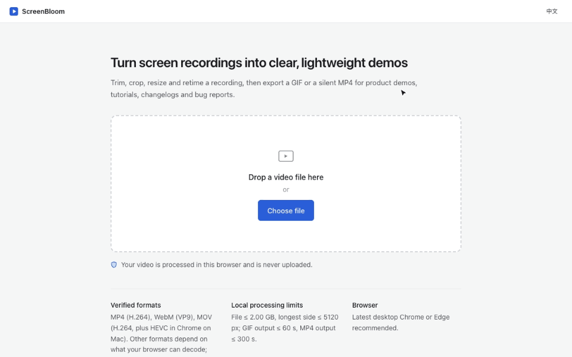
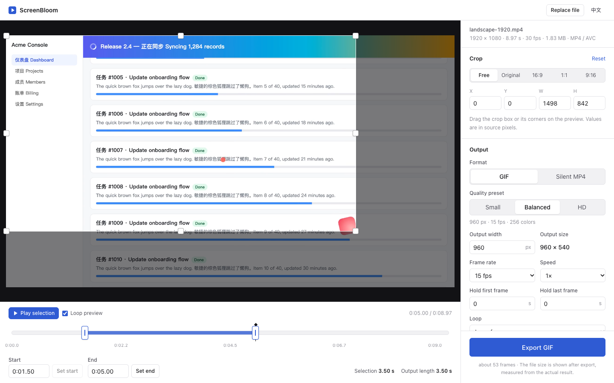

<div align="center">


# ScreenBloom

**Turn videos into beautiful GIFs. Right in your browser.**

A privacy-first GIF maker for developers and creators.

[**Try Online**](https://screenbloom.storyweave.cloud) · [Features](#features) · [Quick Start](#quick-start) · [Contributing](#contributing)

English | [简体中文](README.zh-CN.md)

[](LICENSE)
[](https://github.com/JasonWu0080/ScreenBloom/releases)
[](https://github.com/JasonWu0080/ScreenBloom/actions/workflows/ci.yml)
[](tsconfig.json)
[](package.json)

</div>

Turn screen recordings and videos into optimized GIFs directly in your browser. Trim, crop,
customize, and export without uploading your files.

## Online demo

**[Try ScreenBloom Online → screenbloom.storyweave.cloud](https://screenbloom.storyweave.cloud)**

Nothing to install and no account. Your video is processed in your browser tab and never
uploaded. Use a current desktop Chrome or Edge (see [browser compatibility](#browser-compatibility)).

## Preview

<p align="center">
  
</p>

The walkthrough above was recorded from the real app and converted to GIF **with ScreenBloom
itself** (960 × 600, 12 fps, 13.8 s, 1 MB). It is regenerated by
[`scripts/make-assets.mjs`](scripts/make-assets.mjs).

<details>
<summary>Editor screenshot</summary>



</details>

## Features

Built for GitHub READMEs, bug reports, changelogs, product demos and technical docs.

| Area | What you can do |
| --- | --- |
| Import | Open or drop a local video. Support is decided by actually demuxing and decoding it, not by file extension. |
| Trim | Drag start/end handles or type exact times; "set start / end" from the playhead. |
| Crop | Drag a crop box on the preview, or type pixel values; free, original, 16:9, 1:1, 9:16. Rotated phone videos are handled. |
| Output | Width (never upscaled), frame rate 1–30 fps, speed 0.25–4×, hold first / last frame 0–10 s. |
| Presets | Small (640 px, 10 fps, 128 colors), Balanced (960 px, 15 fps), HD (1280 px, 24 fps, light dithering). |
| GIF | Loop forever or N times, 32–256 colors, optional ordered dithering. |
| Silent MP4 | H.264 video only — there is no audio track at all — with three quality levels. |
| Export | Real progress (frames done / total), elapsed time, cancel at any moment, result preview, download. |
| Languages | English and Simplified Chinese. |

### Local processing limits

Everything runs on the visitor's device, so a few limits keep the tab responsive. They live in
one place, [`src/lib/config.ts`](src/lib/config.ts), and exports that exceed them are blocked
with an explanation before encoding starts.

| Item | Limit |
| --- | --- |
| Source file size | 2 GB (read lazily, never fully loaded into memory) |
| Source frame, longest side | 5120 px (5K) |
| GIF output | ≤ 60 s and ≤ 1500 frames; longest side ≤ 1600 px |
| MP4 output | ≤ 300 s; longest side ≤ 1920 px |

## How it works

```
React UI ──(edit parameters snapshot)──► Dedicated Worker (one per job)
                                           ├─ Mediabunny: demux + WebCodecs VideoDecoder
                                           ├─ crop + high-quality downscale (OffscreenCanvas)
                                           ├─ GIF: global palette → mapping → frame diff → GIF89a + LZW
                                           └─ MP4: WebCodecs VideoEncoder (H.264) → MP4 muxer
```

- Decoding and encoding use the browser's native **WebCodecs**, through [Mediabunny](https://mediabunny.dev) for demuxing and MP4 muxing.
- The **GIF writer and LZW compressor are this project's own code**; color quantization uses the PnnQuant implementation from [`gifenc`](https://github.com/mattdesl/gifenc). Details: [docs/GIF_ENCODER.md](docs/GIF_ENCODER.md).
- Every export runs in a fresh Dedicated Worker that is terminated when the job ends, fails or is cancelled.
- No FFmpeg/WASM: the worker bundle is about 500 KB (≈130 KB gzipped) and needs no special server headers.

On an Apple M4 in Chrome, a 10 s 1080p recording becomes an 800 px, 15 fps GIF in about 1.3 s
([measurements](docs/PERFORMANCE.md)).

## Browser compatibility

ScreenBloom needs WebCodecs, `OffscreenCanvas` and module workers in a secure context (HTTPS
or `localhost`). It checks these at runtime and tells you exactly which API is missing.
MP4 export additionally needs an H.264 encoder; without one, GIF export still works.

| Status | Browsers |
| --- | --- |
| Verified (automated E2E) | Google Chrome on macOS (Apple Silicon) and on Linux (CI, headless) |
| Partially verified | 375 px phone layout in Chrome device emulation (not a real mobile browser) |
| Not tested yet | Edge, Safari, Firefox, Windows, Android, iOS |

Details, evidence and a manual test checklist: [docs/BROWSER_COMPATIBILITY.md](docs/BROWSER_COMPATIBILITY.md).

## Privacy

**Your videos stay in your browser.**

- Video files are opened as local `File` objects and read in chunks inside a Web Worker. Videos, frames, audio, and the exported GIF/MP4 are never uploaded.
- File names are used only for display and for the download file name.
- There is no backend, account, analytics, telemetry, external font or CDN. The page only loads its own static files.
- The end-to-end and smoke tests record every network request while importing and exporting, and fail if any request goes to another origin or is not a `GET` of the app's own files. The smoke test was also run against the production site.
- The recommended deployment sends `Content-Security-Policy: connect-src 'self'`, so the browser itself would block sending data elsewhere.

## Quick start

**Just want to make a GIF?** Open <https://screenbloom.storyweave.cloud>, drop a video, export.

**Run it locally** — requirements: Node.js 24 LTS (≥ 22.12) and a desktop Chromium-based browser.

```bash
git clone https://github.com/JasonWu0080/ScreenBloom.git && cd ScreenBloom
```

```bash
npm ci
```

```bash
npm run dev
```

Open <http://localhost:3000>. Use `localhost` (or HTTPS): browsers only expose WebCodecs in
secure contexts, so opening the dev server via a LAN IP shows an explanation instead of
processing video. To test on other devices, use `npx next dev --experimental-https`.

## Development

| Command | What it does |
| --- | --- |
| `npm run dev` | Development server |
| `npm run check` | Type check + lint + unit tests |
| `npm run build` | Static export to `out/`, with `LICENSE`, third-party notices and `version.json` |
| `npm start` | Serves `out/` at <http://127.0.0.1:4173> with the recommended security headers |
| `npm run samples` | Generates synthetic test videos into `samples/` (needs Google Chrome + ffmpeg) |
| `npm run e2e` | End-to-end tests against the production build in Chrome |
| `npm run e2e:smoke` | Critical-path smoke test; `E2E_BASE_URL=https://…` runs it against a deployment |
| `npm run e2e:stress` | Large-input and limit tests (`node scripts/make-samples.mjs --stress` first) |
| `npm run bench` | GIF export benchmark (median of several runs, optional baseline comparison) |

Project layout:

```
src/
  app/          Next.js entry (static export), metadata, robots/sitemap, icons
  components/   UI: home, editor (preview, crop, timeline, settings, export bar), result
  hooks/        useSourceLoader, useExportJob, usePlayback, useCapabilities
  lib/
    edit/       Domain layer — EditParams, validation, crop geometry, output size, frame timing (pure TS)
    jobs/       Worker message protocol and client (one worker per job)
    media/      Probing, error classification, frame scaling (worker only)
    encode/     GIF and MP4 pipelines; gif/ = palette, frame differencing, GIF89a writer, LZW (worker only)
    i18n/       English / Chinese messages
    capabilities.ts, site.ts, config.ts, format.ts
  workers/      media.worker.ts
```

## Architecture

See [docs/ARCHITECTURE.md](docs/ARCHITECTURE.md) (in Chinese) for layers, data model, worker
protocol, pipelines, resource lifecycle, error model and design decisions, and
[docs/GIF_ENCODER.md](docs/GIF_ENCODER.md) for the GIF encoder.

## Testing

| Suite | Command | Scope |
| --- | --- | --- |
| Unit (Vitest, 69) | `npm test` | Edit parameters and validation, crop geometry, output size, GIF/MP4 frame timing, GIF89a structure, LZW round trips, frame differencing and ghosting regressions under complex motion, error classification, capability detection, formatting |
| End-to-end (Playwright + Chrome, 69) | `npm run e2e` | Real UI and real downloads, checked with ffprobe, an independent GIF parser and a full-frame decode in Chrome: trim, crop, rotation, VFR, presets, loop count, silent MP4, cancel (worker terminated) and re-export, replacing files, object URL cleanup, missing-API message, SEO metadata, Chinese/English, small screens, no cross-origin requests |
| Smoke (46) | `npm run e2e:smoke` | Critical path against any deployment, worker lifecycle and main-thread memory across repeated exports |
| Stress (8) | `npm run e2e:stress` | 5K input, 6K rejection, 60 s GIF, 62 s MP4 |

Latest results: [docs/audits/TEST_REPORT_V1.md](docs/audits/TEST_REPORT_V1.md).

## Deployment

`npm run build` produces a static site in `out/` (about 1.4 MB) that any static host can
serve over **HTTPS**. Tagged releases also attach the build as `screenbloom-vX.Y.Z-static.zip`
(a website for self-hosting, not a desktop app). Each build contains `version.json` with the
version, Git commit and build time, which is also shown at the bottom of the home page.

Set `SITE_URL` at build time if you host your own copy, so canonical and Open Graph links point
to your address; sub-path hosting uses `BASE_PATH`. Full guide with recommended security
headers: [docs/SELF_HOSTING.md](docs/SELF_HOSTING.md).

## Contributing

Contributions are welcome — please read [CONTRIBUTING.md](CONTRIBUTING.md) and the
[Code of Conduct](CODE_OF_CONDUCT.md). Planned work is in [docs/ROADMAP.md](docs/ROADMAP.md).

## Security

Please report vulnerabilities privately as described in [SECURITY.md](SECURITY.md), not in
public issues.

## License

[MIT](LICENSE). The production build bundles third-party code under its own licenses,
including Mediabunny (MPL-2.0); see [THIRD_PARTY_NOTICES.md](THIRD_PARTY_NOTICES.md).
