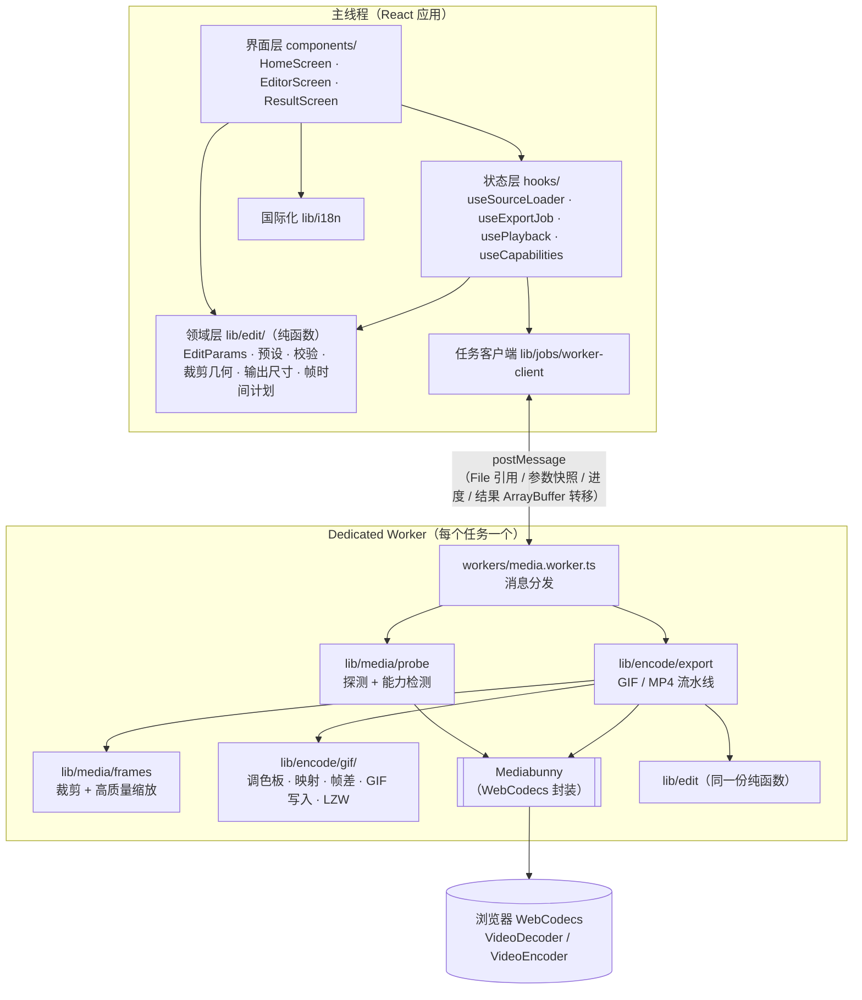
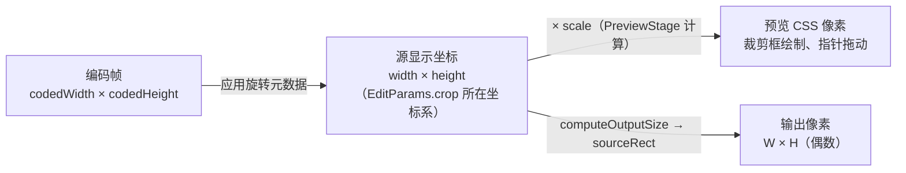
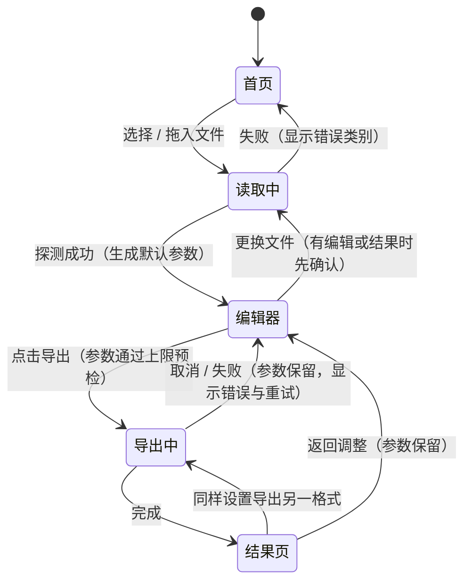
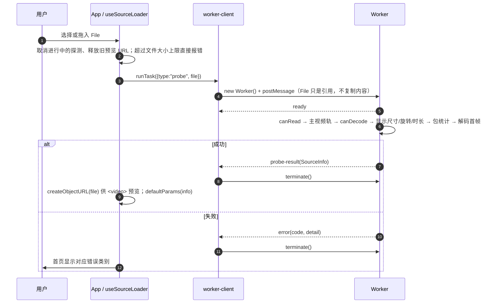
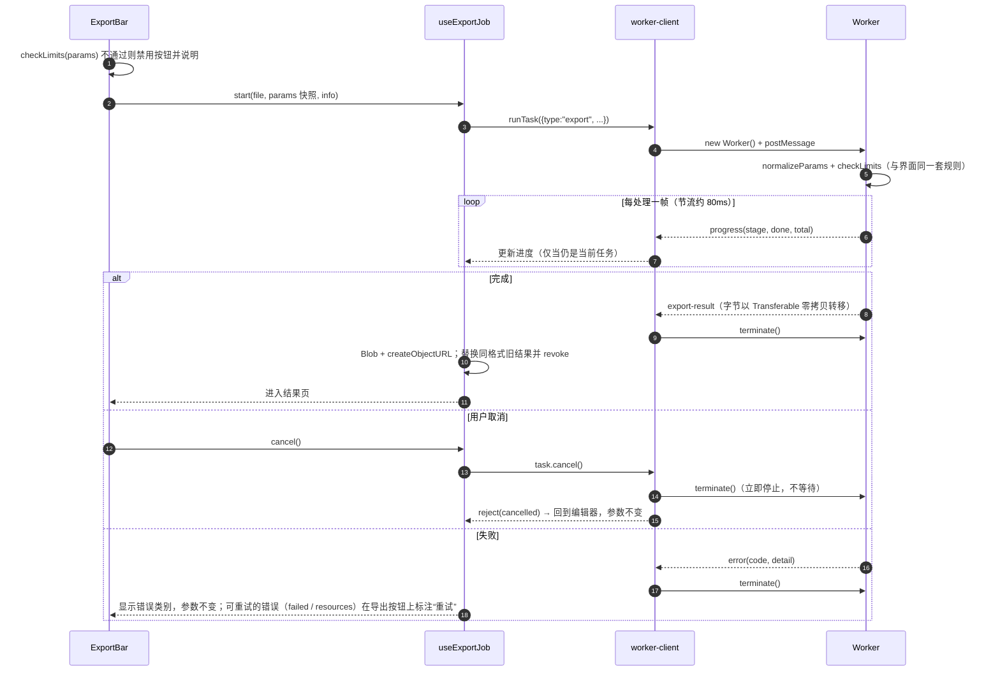
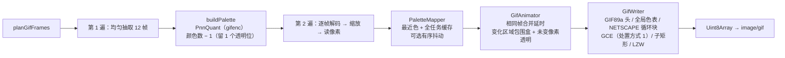
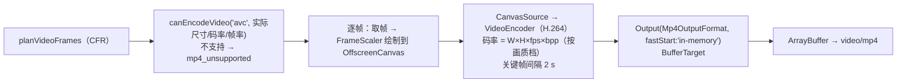

# ScreenBloom — 架构文档

> 适用版本：0.1.0（第一版）
> 本文描述系统的结构、运行时行为、关键算法和设计取舍。使用与运行方法见 [README](../README.md)（[中文](../README.zh-CN.md)）。
> 英文专题文档：[GIF 编码器](GIF_ENCODER.md) · [浏览器兼容性](BROWSER_COMPATIBILITY.md) · [性能](PERFORMANCE.md) · [自托管](SELF_HOSTING.md) · [路线图](ROADMAP.md)。

## 目录

1. [概述](#1-概述)
2. [设计约束与目标](#2-设计约束与目标)
3. [总体架构](#3-总体架构)
4. [模块划分](#4-模块划分)
5. [核心数据模型](#5-核心数据模型)
6. [运行时流程](#6-运行时流程)
7. [编码流水线](#7-编码流水线)
8. [状态与资源生命周期](#8-状态与资源生命周期)
9. [错误模型](#9-错误模型)
10. [国际化与界面](#10-国际化与界面)
11. [构建、部署与运行环境](#11-构建部署与运行环境)
12. [隐私与安全](#12-隐私与安全)
13. [测试架构](#13-测试架构)
14. [关键设计决策](#14-关键设计决策)
15. [扩展点与已知限制](#15-扩展点与已知限制)

---

## 1. 概述

一个纯前端 Web 工具：用户上传已有录屏，在浏览器内完成**截取、裁剪、缩放、变速、首尾停留**，导出 **GIF** 或**静音 MP4**，查看实际结果并下载。

- **没有后端**。构建产物是静态文件，视频只在用户的浏览器内读取和处理。
- **技术栈**：Next.js 16（App Router，静态导出）+ React 19 + TypeScript + Tailwind CSS 4。
- **媒体能力**：浏览器原生 WebCodecs，经由 [Mediabunny](https://mediabunny.dev) 进行解封装、解码和 MP4 封装；GIF 编码为项目自有实现（调色板量化借用 `gifenc`）。

## 2. 设计约束与目标

| 约束 / 目标 | 架构上的对应 |
| --- | --- |
| 默认本地处理，不上传视频 | 无服务器端；文件以 `File` 引用传给 Worker，按需分块读取 |
| 耗时处理不阻塞页面 | 所有解码/编码在 Dedicated Worker 中执行 |
| 取消必须真正终止 | 每个任务一个新 Worker，取消即 `worker.terminate()` |
| 新任务不受旧任务残留状态影响 | 同上：Worker 不复用；主线程用任务引用比对丢弃过期回调 |
| 支持范围以实际能力为准 | 打开文件时在 Worker 内真实解封装 + 解码首帧；MP4 编码能力在 Worker 内实测 |
| 真实进度，不伪造百分比 | 进度只来自 Worker 实际处理的帧数；无可靠百分比的阶段显示阶段名 + 已用时 |
| 编辑参数统一、编辑与编码分离 | 单一 `EditParams` 结构；UI 只改它，导出时发送快照 |
| 大依赖动态加载 | Mediabunny、GIF 编码器只存在于 Worker 包中，选择文件后才下载 |
| 不依赖特殊部署条件 | 不用 SharedArrayBuffer / 多线程 WASM，无需 COOP/COEP |

## 3. 总体架构

### 3.1 分层视图



**依赖方向规则**

- `lib/edit/` 是纯 TypeScript，不依赖 DOM、React 或媒体库，主线程和 Worker 共用。UI 显示的“输出尺寸 / 输出时长 / 预计帧数”与 Worker 实际编码使用的是**同一套函数**，保证所见即所得。
- `mediabunny` 和 `gifenc` 只被 `lib/media/`、`lib/encode/` 引用，而这两者只被 Worker 引用，因此不会进入主页面的 JS 包。
- `components/` 不直接接触 Worker，只通过 `hooks/` 操作任务。

### 3.2 线程模型

| 线程 | 职责 | 不做的事 |
| --- | --- | --- |
| 主线程 | 界面、编辑状态、`<video>` 预览播放、裁剪框交互、结果预览与下载 | 不解码、不编码、不读取文件内容（预览由浏览器 `<video>` 播放 Object URL） |
| Worker | 探测文件、检测编码能力、解码帧、裁剪缩放、GIF/MP4 编码 | 不持有任何 UI 状态；任务结束即被终止 |

预览播放不执行任何编码：编辑时拖动时间轴、调整裁剪，只影响 `<video>` 的播放位置和覆盖层，不会反复执行 GIF 编码。

## 4. 模块划分

```
src/
├─ app/                     Next.js 入口：layout（挂 I18nProvider）、page、全局样式与设计令牌
├─ components/
│  ├─ App.tsx               应用编排：首页 → 编辑器 ⇄ 结果；持有 EditParams
│  ├─ HomeScreen.tsx        上传（选择/拖放）、读取中状态、能力边界说明、读取错误
│  ├─ editor/
│  │  ├─ EditorScreen.tsx   编辑器布局：预览 + 时间轴 + 设置面板 + 导出栏
│  │  ├─ PreviewStage.tsx   视频等比适配显示区域，计算 源像素↔CSS 像素 比例
│  │  ├─ CropOverlay.tsx    裁剪框：拖动 / 8 个手柄 / 键盘微调
│  │  ├─ Timeline.tsx       起止手柄、点击定位、精确时间输入、设为起点/终点
│  │  ├─ SettingsPanel.tsx  裁剪比例与数值、格式、预设、尺寸、帧率、速度、停留、循环、高级设置
│  │  └─ ExportBar.tsx      上限预检、导出按钮、真实进度、取消、错误与重试
│  ├─ ResultScreen.tsx      实际导出文件预览、真实属性、下载、返回调整、另一格式导出
│  ├─ ConfirmDialog.tsx     更换文件确认（原生 <dialog>）
│  ├─ errors.tsx            错误码 → 文案；技术详情折叠显示
│  └─ ui.tsx                基础控件：Button、Segmented、Field、CommitInput、Select、Notice
├─ hooks/
│  ├─ useSourceLoader.ts    打开文件 = Worker 探测；管理预览 Object URL
│  ├─ useExportJob.ts       导出任务状态机、进度、取消；结果 Object URL 与结果缓存
│  ├─ usePlayback.ts        预览只在选区内播放、按输出速度、循环或停止
│  └─ useCapabilities.ts    安全上下文/API 检测（同步）；H.264 编码能力检测（Worker）
├─ lib/
│  ├─ config.ts             本地处理上限（唯一配置点）
│  ├─ capabilities.ts       必需浏览器 API 清单与缺失检测（主线程与 Worker 共用，纯函数）
│  ├─ site.ts               产品名、公开 URL、构建版本信息（构建时注入）
│  ├─ format.ts             时间/大小格式化与解析、下载文件名
│  ├─ edit/                 ★ 领域层（纯函数）
│  │  ├─ types.ts           EditParams、SourceInfo、Rect 等类型
│  │  ├─ params.ts          默认值、预设、预设识别、参数规范化、上限检查、MP4 码率
│  │  ├─ crop.ts            比例、适配、夹取、拖动几何、数值输入、坐标映射
│  │  ├─ output.ts          有效输出尺寸（偶数、不放大、上限）与精确源区域
│  │  └─ timeline.ts        GIF 帧计划（厘秒延时）与 MP4 恒定帧率计划
│  ├─ media/                （仅 Worker）
│  │  ├─ probe.ts           打开输入、探测信息、解码首帧、编码能力检测
│  │  ├─ frames.ts          FrameScaler：裁剪 + 分级减半高质量缩放（GPU 加速画布）
│  │  └─ errors.ts          JobError 与异常分类
│  ├─ encode/               （仅 Worker）
│  │  ├─ export.ts          GIF / MP4 导出流水线
│  │  └─ gif/               palette.ts · animator.ts · writer.ts（GIF89a + LZW）
│  ├─ jobs/
│  │  ├─ protocol.ts        主线程 ⇄ Worker 消息类型、错误码、阶段
│  │  └─ worker-client.ts   runTask：创建 Worker、转发进度、结算、终止
│  └─ i18n/                 messages.ts（中/英文案，键类型约束）· I18nProvider.tsx
├─ workers/media.worker.ts  Worker 入口
└─ types/gifenc.d.ts        gifenc 的类型声明
```

## 5. 核心数据模型

### 5.1 `EditParams` —— 唯一的“导出什么”

定义于 `src/lib/edit/types.ts`。界面只编辑它；开始导出时把当时的快照发给 Worker。

| 字段 | 含义 | 单位 / 取值 |
| --- | --- | --- |
| `start`, `end` | 片段起止 | 源时间轴秒 |
| `crop` | 裁剪矩形 `{x, y, width, height}` | **源显示像素**（已应用旋转） |
| `aspect` | 比例锁定 | `free` / `original` / `1:1` / `16:9` / `9:16` |
| `outputWidth` | 请求的输出宽度 | px；有效尺寸由 `computeOutputSize` 决定 |
| `fps` | 输出帧率 | 1–30 |
| `speed` | 播放速度 | 0.25–4，2 表示两倍速 |
| `holdStart`, `holdEnd` | 首尾停留 | 秒，0–10 |
| `format` | 输出格式 | `gif` / `mp4` |
| `gifLoop` | GIF 循环 | 0 = 无限；N ≥ 1 = 共播放 N 次 |
| `preset` | 当前预设 | `small` / `balanced` / `hd` / `custom` |
| `gifColors`, `gifDither` | GIF 颜色数、抖动 | 16–256、布尔 |
| `mp4Quality` | MP4 画质档 | `low` / `medium` / `high` |

**不变式**（由 `normalizeParams` 在每次修改后保证）：

- `0 ≤ start < end ≤ duration`，且 `end − start ≥ 0.1 s`；
- `crop` 为整数、位于画面内、不小于 16 px；有比例锁定时比例与锁定值一致；
- 其余数值字段落在 `LIMITS` 范围内；
- `preset` 由 `detectPreset` 推导：与某个预设的取值完全一致即为该预设，否则为 `custom`。时间、速度、停留、循环不参与预设判断。
- 枚举字段（`format`、`aspect`、`mp4Quality`、`preset`、`gifDither`）和非有限数值（`NaN`/`Infinity`）也会被纠正为合法值。

**Worker 端再校验**：Worker 收到导出请求后，先对参数快照再次执行同一个 `normalizeParams`（使用请求中附带的 `SourceInfo`）和 `checkLimits`，不通过则以 `failed` 拒绝。界面产生的参数是 `normalizeParams` 的不动点（有单元测试保证），因此再校验不会改变正常导出的结果，只是保证非法参数无法进入编码流水线。

### 5.2 `SourceInfo` —— 实际探测到的源文件信息

由 Worker 打开文件并解码首帧后得到：容器、编码、时长、首帧时间戳、**显示尺寸**（旋转后）、编码尺寸、旋转角、平均帧率、是否有音轨、文件名与大小。

### 5.3 坐标系



- **裁剪始终以源显示像素保存**。窗口尺寸变化只改变 `scale`，裁剪本身不变。
- 预览区域按源显示比例等比缩放，因此一个 `scale` 即可双向换算：`css = src × scale`，`src = css / scale`。
- 旋转只在“编码帧 → 源显示坐标”这一步处理一次。预览由浏览器 `<video>` 应用旋转，导出由 Mediabunny `CanvasSink` 应用旋转，两者都落到同一坐标系。

### 5.4 输出尺寸规则（`computeOutputSize`）

1. `width = min(请求宽度, 裁剪宽度, 格式宽度上限)`，并保证最长边不超过格式上限 → **不放大**；
2. 宽高都取**偶数**（H.264 4:2:0 的要求；GIF 也使用同一规则，使同一编辑的两种格式尺寸一致）；
3. 取整会让比例产生微小偏差，因此把**源区域**沿较长方向居中微调到与输出比例完全一致（最多约 1–2 个输出像素对应的源像素），**不拉伸画面**。

## 6. 运行时流程

### 6.1 页面状态



### 6.2 打开文件



### 6.3 导出、进度与取消



**过期回调防护**：`useSourceLoader` 与 `useExportJob` 都保存“当前任务”引用。任何回调到达时若任务已被替换或取消，结果直接丢弃，因此快速连续操作不会出现旧结果覆盖新状态。

### 6.4 预览播放（`usePlayback`）

- 播放速度设为 `params.speed`，预览即可反映输出节奏；
- 播放期间用 `requestAnimationFrame` 检查边界，到达终点时按“循环预览”开关回到起点或停在终点；
- 拖动时间轴手柄时视频跳到手柄位置，用户可以看到边界帧。

## 7. 编码流水线

### 7.1 时间映射（`lib/edit/timeline.ts`）

输出片段内时间 `t` 对应源时间 `start + t × speed`。

```
片段输出时长 clip  = (end − start) / speed
总输出时长   total = holdStart + clip + holdEnd
```

| | GIF：`planGifFrames` | MP4：`planVideoFrames` |
| --- | --- | --- |
| 帧数 | `max(1, round(clip × fps))` | `max(1, round(total × fps))`，恒定帧率 |
| 采样时间 | `start + (i / fps) × speed` | 停留段取首/末片段帧，其余同左 |
| 时长 | 由**累计边界取整**得出厘秒延时（15 fps → 7,7,6…），总和精确等于 `total` | 每帧 `1/fps`，最后一帧修正，使文件时长精确等于 `total` |
| 首尾停留 | 加到第一帧 / 最后一帧的延时上 | 重复首帧 / 末帧 |
| 特殊处理 | 延时 < 2 cs 的尾帧并入前一帧（浏览器会把 <2 cs 当作 10 cs） | — |

### 7.2 取帧与缩放

- `framesAt()`：用 Mediabunny `CanvasSink.canvasesAtTimestamps()` 按**单调递增的时间戳**取帧，每个数据包最多解码一次。时间戳小于首帧时钳到首帧；可变帧率文件中个别时间点取不到帧时，沿用上一帧，保证时间轴不偏移。
- `FrameScaler`：从已旋转的整帧中按 `sourceRect` 裁出，再缩放到输出尺寸。缩小超过 2 倍时**逐级减半**（每级 `imageSmoothingQuality = "high"`），避免小字发虚或锯齿。
- 输出画布**不**设置 `willReadFrequently`：该提示会让画布改为 CPU 渲染，缩放全部由软件完成。保持 GPU 加速、每帧只读回一次较小的输出画面，在 1080p → 800 px GIF 基准中快 26%，画质相同（见 [PERFORMANCE.md](PERFORMANCE.md)）。

### 7.3 GIF 流水线



| 环节 | 做法 | 目的 |
| --- | --- | --- |
| 全局调色板 | 跨片段抽样 12 帧统一量化 | 颜色帧间稳定，不闪烁；为帧差优化提供前提 |
| 颜色映射缓存 | 每通道 7 位作为键，整个任务共享 | 同一颜色始终映射到同一索引（时间稳定）且速度快 |
| 加权距离 | `2·ΔR² + 4·ΔG² + 3·ΔB²` | 更接近人眼对亮度的敏感度 |
| 有序抖动（仅“高清”） | Bayer 8×8，只作用于调色板误差大的颜色 | 渐变不出色带；文字和纯色不加噪点；按位置固定，静止区域不闪 |
| 帧差 | 只写变化区域的包围矩形，未变像素设为透明 | 录屏大面积静止，体积大幅下降 |
| 相同帧合并 | 与上一帧完全相同则只累加延时 | 停顿几乎不占体积，总时长不变 |
| 循环 | 0 → 写 0（无限）；N=1 → 不写循环块；N≥2 → 写 N−1 | NETSCAPE 计数表示“首次播放后的重复次数” |
| LZW | 自实现；字典为平铺表 + 代数戳，清表 O(1) | 大帧频繁清表时仍然快速 |

### 7.4 MP4 流水线



- **只添加视频轨，从不添加音轨**：文件本身就是静音的，不是把播放器静音。
- `source.add()` 返回的 Promise 会被等待，从而尊重编码器的背压，内存不会无限增长。
- 出错时调用 `output.cancel()` 释放编码器。

### 7.5 内存与性能要点

- **输入**：`BlobSource` 按需读取（默认最多缓存 8 MiB），2 GB 文件不会整体载入内存。
- **帧**：`CanvasSink` 使用大小为 2 的画布池；GIF 每帧复用同一个索引缓冲区。
- **输出**：结果字节通过 `postMessage` 的 Transferable 转移到主线程，不复制。
- **参考数据**（Apple M4、Chrome 155，2026-10-13 实测）：60 s / 960 px / 15 fps 的 GIF 9.3 s；5K 源到 1280 px GIF（5 s）9.9 s；62 s / 960 px 的 MP4 2.8 s。测试方法与完整数据见 [PERFORMANCE.md](PERFORMANCE.md)。

## 8. 状态与资源生命周期

### 8.1 状态归属

| 状态 | 所有者 | 说明 |
| --- | --- | --- |
| 源文件、`SourceInfo`、预览 URL | `useSourceLoader` | `idle / loading / error / ready` |
| `EditParams` | `App` | 每次修改：`fn(prev)` → `normalizeParams` → `detectPreset` |
| 导出任务 | `useExportJob` | `idle / running(progress, startedAt) / error(code, detail)` |
| 导出结果 | `useExportJob` | 按格式各保存一份，并记录生成它的 `editKey` |
| 播放位置、播放中、循环预览 | `usePlayback` / `EditorScreen` | 只影响预览，不影响导出 |
| 页面视图 | `App` | `editor / result`，以及正在查看哪种格式的结果 |

`editKey(params)` 是除 `format` 外全部参数的序列化值。参数一旦改变，与当前 `editKey` 不一致的结果会被立即释放；只切换格式不会使已有结果失效，所以“同一编辑分别导出两种格式”可以并存。

### 8.2 资源释放

| 资源 | 创建 | 释放 |
| --- | --- | --- |
| 预览 Object URL | 探测成功后 | 更换文件、`reset()`、组件卸载 |
| 结果 Object URL | 导出完成后 | 同格式新结果替换、编辑变化导致结果失效、更换文件、卸载 |
| Worker | 每个任务开始时 | 完成、失败、取消时一律 `terminate()` |
| Mediabunny `Input` | 每次探测 / 导出 | `finally { input.dispose() }` |
| 缩放用 OffscreenCanvas | 每次导出 | `finally { scaler.dispose() }`（宽高置 1，释放显存） |
| MP4 `Output` | 每次 MP4 导出 | 出错时 `output.cancel()` |

## 9. 错误模型

Worker 内的异常由 `classifyError` 归类为面向用户的错误码，主线程按错误码显示文案；原始技术信息只放在可折叠的“技术详情”中。`protocol.ts` 的 `isRetryable(code)` 标记哪些错误值得原样重试（只有 `failed` 与 `resources`），其余错误需要换文件、换浏览器或换格式，界面不会把它们表述为“重试”。

| 错误码 | 用户含义 | 典型来源 |
| --- | --- | --- |
| `unreadable` | 文件无法读取（非视频 / 损坏 / 不认识的封装） | `canRead` 为 false、`UnsupportedInputFormatError`、解码 `EncodingError` |
| `no_video` | 找不到可用视频轨（只有音频或文件不完整） | 无主视频轨 |
| `empty` | 无可用画面或时长为 0 | 时长 ≤ 0、首帧解码不出 |
| `unsupported_codec` | 浏览器无法解码该编码 | `canDecode` 为 false（附编码名） |
| `source_too_large` | 超出本地处理上限 | 文件大小、画面最长边 |
| `mp4_unsupported` | 浏览器不能生成 MP4 | `canEncodeVideo('avc')` 为 false |
| `resources` | 本地资源不足 | 内存分配失败、`QuotaExceededError` 等 |
| `load_failed` | 处理模块加载失败 | Worker 在发出 `ready` 之前就报错 |
| `browser_unsupported` | 缺少必要的浏览器 API | Worker 内 `missingApis()` 非空（详情中列出缺失的 API） |
| `failed` | 其他转换失败 | 兜底 |
| `cancelled` | 用户取消 | 不显示为错误，直接回到编辑器 |

此外，主线程在页面加载时同步检测运行环境（`localProcessingSupport` → `lib/capabilities.ts` 的 `missingApis()`）：页面不是安全上下文（非 HTTPS、非 localhost）时，提示用户改用 HTTPS 或 localhost；缺少 `Worker`、`VideoDecoder`、`EncodedVideoChunk`、`VideoFrame`、`OffscreenCanvas`（含 2D 上下文）中的任意一项时，**逐项列出缺失的 API** 并提示换用浏览器。两种情况都会禁用上传。H.264 编码能力单独检测：先用 1280×720 配置给出界面提示（不可用时说明 GIF 仍可导出），每次 MP4 导出前再用实际尺寸、码率和帧率调用 `canEncodeVideo` 复核——仅有 `VideoEncoder` 不代表 H.264 可用。

## 10. 国际化与界面

- **文案**：`lib/i18n/messages.ts` 中，中文字典的键定义了类型 `MessageKey`，英文字典必须实现全部键（编译期检查），支持 `{name}` 插值。
- **语言选择**：静态 HTML 以英文渲染（搜索引擎和链接预览读取的内容，与英文 `<title>`/描述一致）；挂载后按 `localStorage` 或浏览器语言切换，并同步 `<html lang>` 与本地化的页面标题。两种语言共用同一个 URL，因此只有一个 canonical，不设置 hreflang。
- **布局**：
  - 桌面（`lg` 及以上）：左侧预览 + 底部时间轴，右侧 360 px 设置面板；导出栏固定在面板底部。
  - 小屏：预览 → 时间轴 → 设置 → 导出依次排列；所有拖动操作都有数值输入作为替代。
- **视觉**：设计令牌集中在 `globals.css` 的 CSS 变量中，中性灰为主，一个强调色，并映射为 Tailwind 主题色（`bg-surface`、`text-ink-2`、`bg-accent` 等）。
- **可访问性**：时间轴手柄为 `role="slider"`（方向键 ±0.1 s，Shift ±1 s）；裁剪框可用方向键移动；分段控件为 `radiogroup`；进度条带 `aria-valuenow`。

## 11. 构建、部署与运行环境

| 项目 | 说明 |
| --- | --- |
| 构建 | `npm run build`：`prebuild`（`scripts/build-info.mjs`）记录版本号、Git 提交（工作区有未提交修改时带 `-dirty`）和构建时间；`next build`（`output: "export"`）把它们编译进页面，产物在 `out/`；`postbuild`（`scripts/postbuild.mjs`）把 `LICENSE`、`THIRD_PARTY_NOTICES.md` 和 `version.json` 复制进 `out/`（压缩会去掉依赖的许可证注释，MPL-2.0 的 Mediabunny 需要随产物附带声明） |
| SEO 与分享 | `app/layout.tsx` 的 metadata（标题、描述、canonical、Open Graph、Twitter Card、SoftwareApplication JSON-LD）；`app/robots.ts`、`app/sitemap.ts`（`force-static`）；`public/og-image.png`。绝对地址基于构建时的 `SITE_URL`（默认生产地址） |
| Worker 打包 | `new Worker(new URL("../../workers/media.worker.ts", import.meta.url), { type: "module" })`，Turbopack 单独打包为一个 chunk（约 500 KB，gzip 后约 130 KB），只在第一次运行任务时下载 |
| 托管 | 任意静态服务器 / 对象存储 / CDN；`.js` 需以 JavaScript MIME 类型提供 |
| 响应头 | 不需要 COOP/COEP。推荐的安全响应头（CSP、nosniff 等）见 [SELF_HOSTING.md](SELF_HOSTING.md)；`npm start` 与 e2e 测试使用同一组响应头，保证其与 Worker、WebCodecs、blob 预览兼容 |
| 子路径部署 | 构建时设置环境变量 `BASE_PATH`（如 `BASE_PATH=/tools/gif npm run build`），由 `next.config.ts` 传给 `basePath`；已实测子路径下打开文件并导出 GIF |
| 运行前提 | 安全上下文（HTTPS 或 localhost）；支持 WebCodecs、OffscreenCanvas、模块 Worker 的浏览器 |
| 开发 | `next dev`；`allowedDevOrigins` 允许局域网地址加载开发资源（仅开发模式），但视频处理仍需要 HTTPS 或 localhost |

## 12. 隐私与安全

- 视频内容、文件名、帧画面都不离开浏览器。文件名只用于界面显示和下载文件名。
- 没有任何统计、埋点、外部字体或第三方请求；除站点自身的静态资源外不发起网络请求。
- 首页的“文件在浏览器内处理，不会上传”与实现一致。外部依赖只在构建期打包，运行时从站点自身加载，与“上传视频”是两件事。
- 错误详情只显示给用户本人，不写入日志，也不发送到任何地方。
- e2e 测试在整个导入/导出过程中记录全部网络请求，出现跨域请求或非 `GET` 请求即失败；推荐部署的 CSP 使用 `connect-src 'self'`，在浏览器层面阻止向其他源发送数据。

## 13. 测试架构

| 层级 | 位置 | 内容 |
| --- | --- | --- |
| 单元测试（Vitest，69 项） | `tests/unit/` | 时间映射与速度、停留、厘秒取整（多帧率/速度/停留组合无累计误差）；裁剪几何；输出尺寸；参数规范化（幂等、非法快照纠正）与预设识别；错误分类与可重试判定；GIF89a 结构（全局色表、GCE、图像描述符、透明、处置方式、最小码长、循环块、超长延时拆分）；LZW 往返（含多次字典清表）；GIF 流水线像素级回归（静态界面、鼠标移动、滚动、渐变抖动、文字、高频动画、长时间静止、多物体重叠运动、A→B→A 回退、物体移出画面）；格式化与解析、能力检测、版本号显示。GIF 输出均由独立解码器 `tests/unit/gif-decoder.ts` 校验 |
| 端到端（Playwright + Chrome，69 项） | `tests/e2e/run.mjs` | 通过真实界面操作并下载真实文件，用 ffprobe 检查编码、流数量、尺寸、时长、帧数和无音轨；用 GIF 块解析器检查逐帧延时与循环值；用 Chrome `ImageDecoder` 完整解码每一帧（帧数、尺寸、总时长、最后一帧合成后无透明像素）并检查循环；取消后 Worker 已终止；缺少 WebCodecs 时的逐项提示；SEO 元数据、robots/sitemap/OG 图片/version.json；验证旋转、VFR、损坏文件、取消后重导出、更换文件确认与资源释放、中英文与小屏无溢出、裁剪拖动与窗口缩放、无跨域/非 GET 请求。HEVC 样本只能在 macOS 生成，其他平台自动跳过该项 |
| 冒烟测试 | `tests/e2e/smoke.mjs` | 关键路径，可通过 `E2E_BASE_URL` 指向任意部署（含生产环境）；额外检查 Worker 数量、连续导出时主线程堆内存、4xx/5xx |
| 上限与性能（8 项） | `tests/e2e/stress.mjs` | 5K 源、6K 源被拒绝、62 s 超限提示、60 s GIF、62 s MP4 |
| 基准测试 | `tests/bench/gif-bench.mjs` | 1080p/10 s/30 fps → 800 px/15 fps GIF，多次运行取中位数，可与基线比较相对回归 |
| 测试素材 | `scripts/make-samples.mjs` | 用 Chrome 录制含中英文、滚动、渐变、动画的网页，再用 ffmpeg 生成 MP4 / WebM / MOV / HEVC / 旋转 / VFR / 损坏样本（合成素材，非真机录屏） |

## 14. 关键设计决策

| # | 决策 | 备选 | 理由 |
| --- | --- | --- | --- |
| D1 | WebCodecs + Mediabunny | FFmpeg WASM | 包体小约两个数量级；硬件解码快；无需跨源隔离响应头；避免 GPL 组件。代价：能力取决于浏览器（Safari/Firefox 未验证） |
| D2 | 每个任务一个新 Worker，取消即终止 | 复用常驻 Worker + 取消标志 | 真正立即停止；天然无残留状态；Worker 启动成本（毫秒级）可以忽略 |
| D3 | 自写 GIF 写入器与 LZW | 直接用 gifenc 编码器 | gifenc 不支持子矩形偏移，延时按毫秒换算有取整误差；帧差和精确厘秒延时需要自己控制 |
| D4 | 全局调色板 + 有序抖动 | 逐帧调色板、Floyd–Steinberg | 逐帧调色板和误差扩散都会让静止区域在帧间变化，造成闪烁并破坏帧差压缩 |
| D5 | MP4 恒定帧率，停留用重复帧 | 单帧拉长时长（VFR） | 对播放器和剪辑软件兼容性最好；重复帧编码后几乎不占空间 |
| D6 | GIF 与 MP4 都用偶数尺寸，源区域微调 | 只对 MP4 取偶数 / 拉伸 | 统一规则，同一编辑两种格式尺寸一致，且不拉伸 |
| D7 | 静态导出 | 服务端渲染 | 无后端需求；部署最简单；与“本地处理”的定位一致 |
| D8 | 领域逻辑为纯函数并由主线程与 Worker 共用 | 两端各自计算 | 界面显示的尺寸、时长、帧数与实际输出一致，且易于单元测试 |

## 15. 扩展点与已知限制

### 扩展点

- **新输出格式**（如 WebP / APNG / WebM）：在 `OutputFormat` 中增加取值，在 `lib/encode/export.ts` 增加对应流水线，在 `LIMITS` 增加上限，在 `SettingsPanel` 增加选项。`EditParams` 的其余部分保持不变。
- **浏览器录屏**：新增一个产生 `File`/`Blob` 的入口，交给现有的 `useSourceLoader.load()` 即可，后续流程不需要改动。
- **新预设**：在 `PRESETS` 中加一项，并补充文案。
- **上限调整**：只修改 `src/lib/config.ts`。
- **编辑能力**（如遮挡、文字标注）：在 `FrameScaler.draw` 之后、像素读取 / 编码之前加入一步绘制，参数加到 `EditParams`。

### 已知限制

- 只在 macOS 桌面版 Chrome 上做过自动化验证；Safari、Firefox、移动浏览器未验证。
- 测试素材为合成录屏，未覆盖真实设备录屏的全部元数据变体、HDR/10-bit。
- 转换前不预测文件大小，以导出后的真实大小为准。
- 有限循环的 GIF 在部分查看器中可能被忽略；MP4 的循环由播放器决定。
- 结果只保存在当前页面内存中，刷新后需要重新导出。
